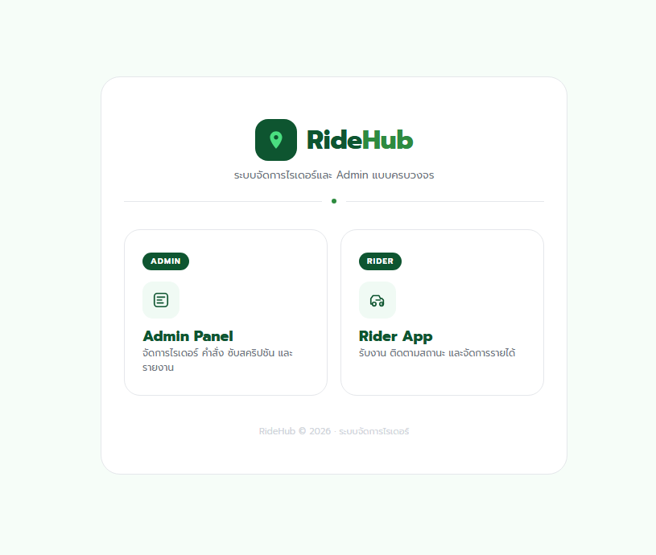
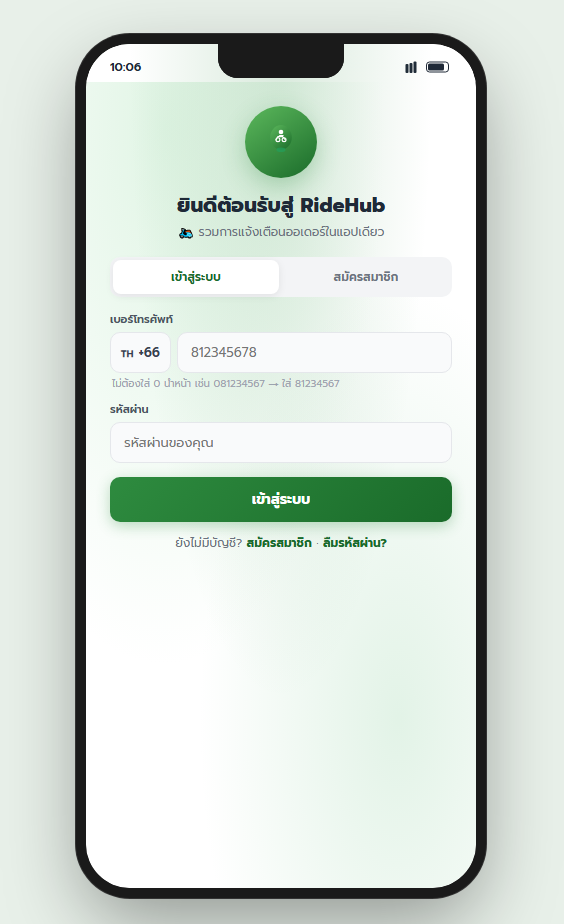
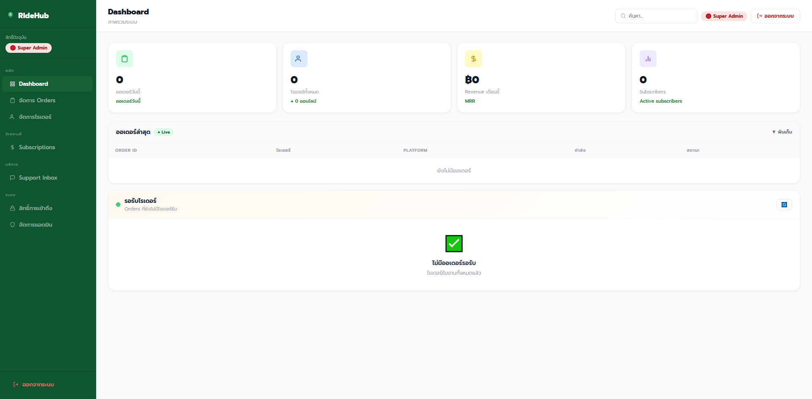

# RideHub

A management system for delivery riders, with a **Rider App** and an **Admin Panel** that share one real-time database.

ระบบจัดการไรเดอร์และแอดมินแบบครบวงจร — ไรเดอร์รับงาน ติดตามรายได้ และติดต่อแอดมินได้ในที่เดียว

**Live demo:** https://polypiku09-crypto.github.io/ridehub/



## Features

### Rider App (`ridehub_ride.html`)
- Sign up and log in as a rider
- Receive new orders in real time
- Order history with filters by platform (Grab, LINE MAN, ShopeeFood)
- Earnings overview
- Subscription plans for riders
- Live support chat with admins
- Rider profile, with a PDPA privacy policy and consent

### Admin Panel (`ridehub_admin.html`)
- Dashboard of riders and recent orders
- Track orders by status: pending, delivering, completed, cancelled
- Manage subscribers and subscription plans
- Real-time support inbox for all riders
- Manage admin users and remove rider accounts

## Tech Stack

| Part | Technology |
|------|------------|
| Frontend | HTML, CSS, JavaScript (no framework) |
| Backend & database | [Supabase](https://supabase.com) (PostgreSQL) |
| Real-time updates | Supabase Realtime channels |
| Auth | Supabase Auth |
| Hosting | GitHub Pages |

## Database Tables

`riders`, `rider_auth`, `orders`, `plans`, `subscriptions`, `support_messages`, `admin_users`, `admin_sessions`

## Screenshots

| Rider App | Admin Panel |
|-----------|-------------|
|  |  |

## Run Locally

No build step is needed.

```bash
git clone https://github.com/polypiku09-crypto/ridehub.git
cd ridehub
# open index.html in a browser, or serve the folder:
npx serve .
```

## My Role

<!-- Write 2–3 lines in your own words: what you designed and built yourself,
     e.g. the database design, the real-time order flow, the admin dashboard. -->

---
Built as a university mini project.
